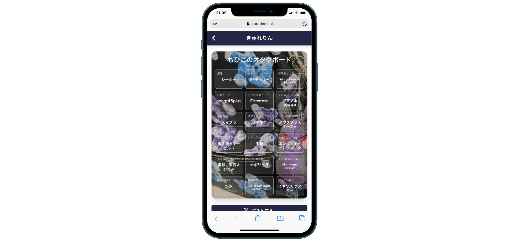
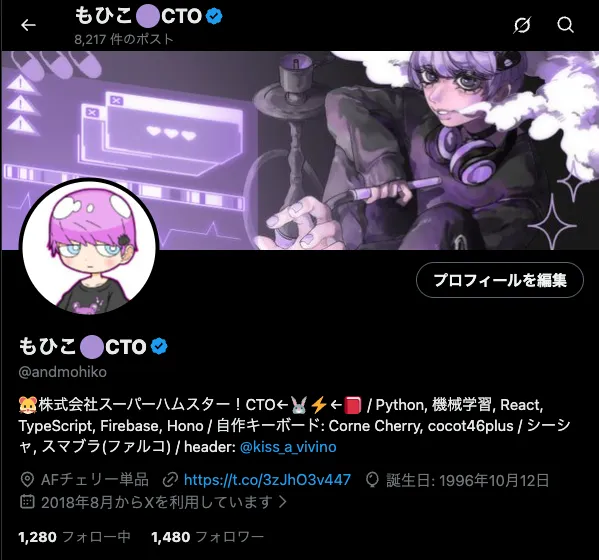
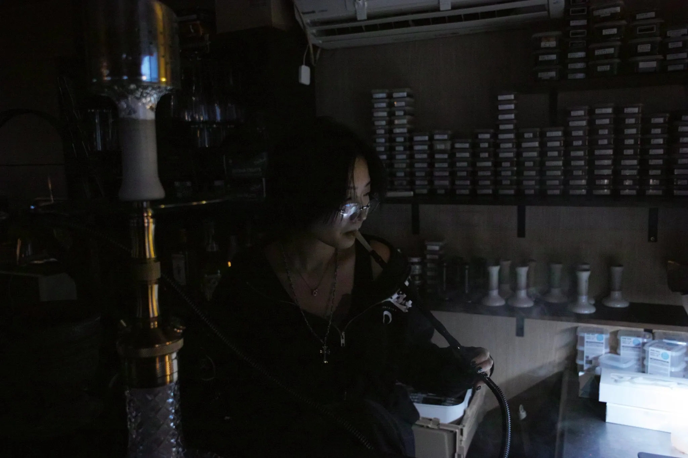
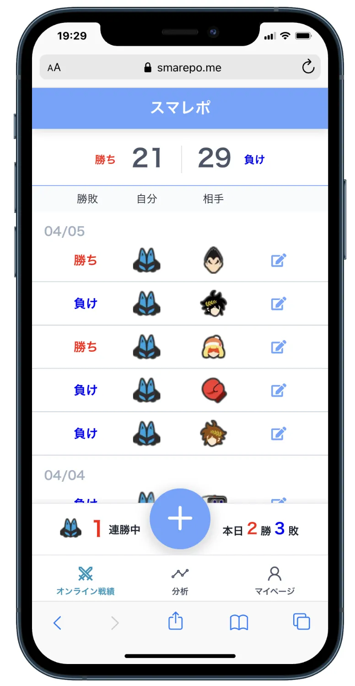
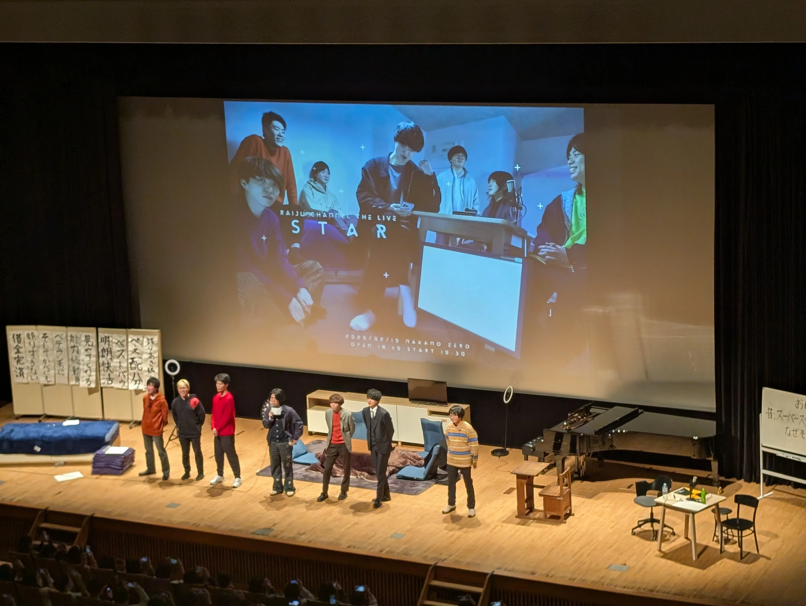
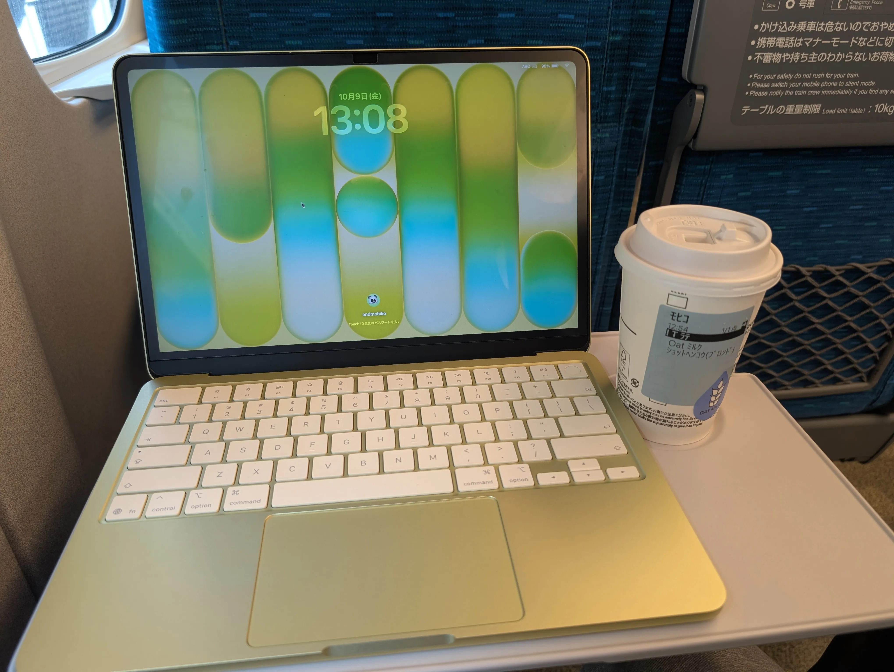
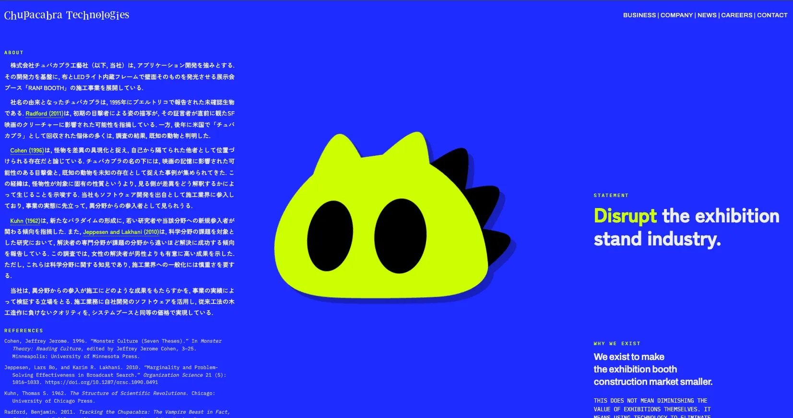
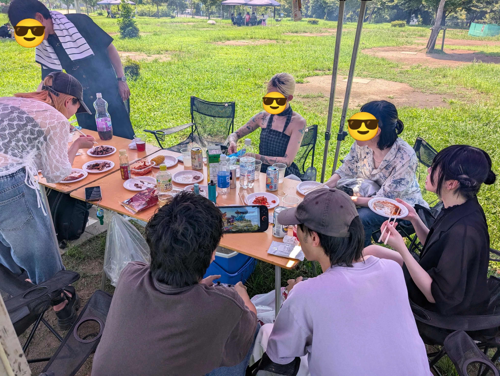
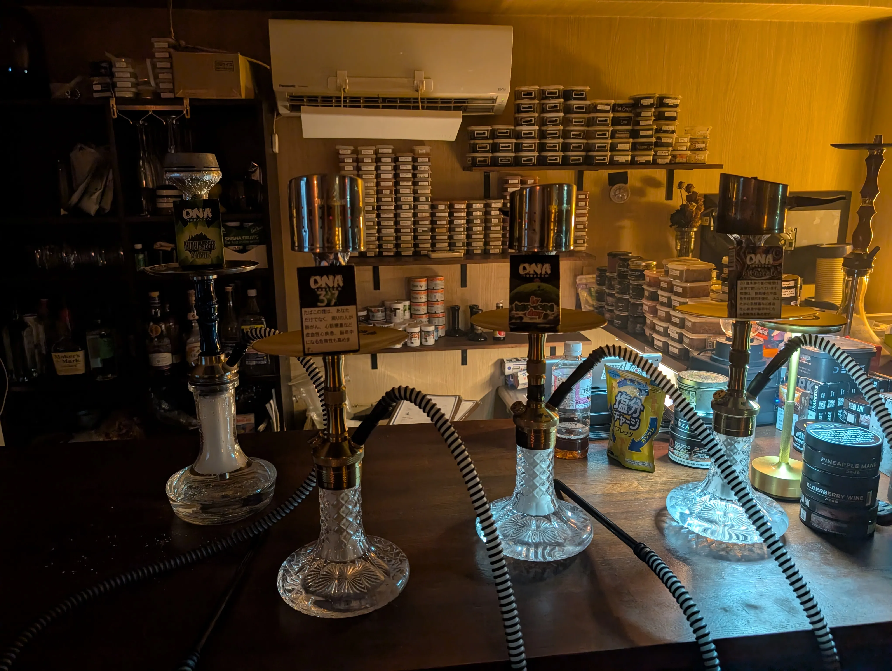
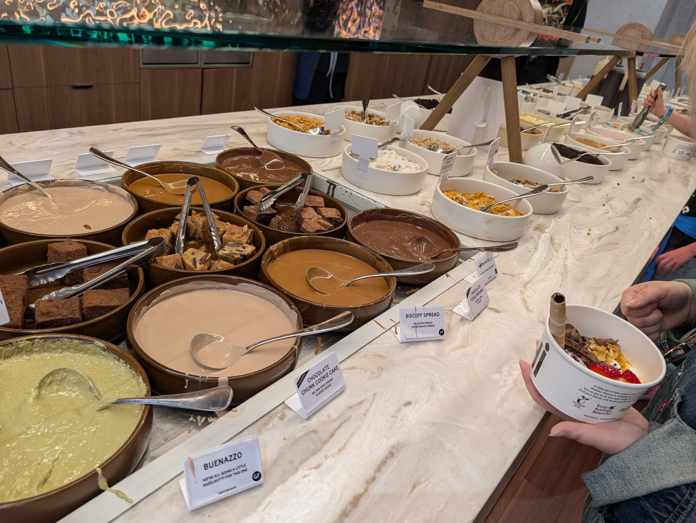

30歳になったので29歳を振り返ります。

## 振り返り

### 2025/10-12月

去年から引き続き、スーパーハムスターのCTOとして、受託開発でPMをやっていました。この頃はCursorをメインで使っていました。
メンヘラテクノロジー時代にはじめてフルコミで採用したエンジニアがついに転職することになりました。自分が採用・教育したエンジニアが他社からも魅力的だと思ってもらえたのがうれしい反面、3年間一緒にコードを書いてきたメンバーが離れるさみしさもあり、落ち込んでいました。

クソアプリAdvent Calendar2025では[キュレーションリンク](/works/curate)というアプリを作りました。詳しくは[こちらのZenn](https://zenn.dev/andmohiko/articles/6fbf70b37c9b2b)に書いています。このあとに「私を構成する9つの⚪︎⚪︎」系が流行り、悔しかったです。

12月に桜庭微々乃ちゃん（[@kiss_a_vivino](https://x.com/kiss_a_vivino)）にXのヘッダーを描いてもらいました。普段シーシャを吸っているときのもひこのディティールも汲み取ってくれていて、依頼してよかったです。

カメラではじめて人の写真を撮りました。[御茶ノ水シーシャWARPのツバキさんです。](https://x.com/shisha_tsubaki/status/2004109172720501008)
Sigmaの暗い味が出せて楽しかったです。

学生の頃に作った個人開発 [スマレポ](/works/smarepo) をフルリプレイスしました。Nuxt.jsの2系で書かれていたコードベースをメンテすることをやめ、Next.jsとTypeScriptで実装し直しました。詳しくは[こちらのブログ](/blogs/smarepo-renewal)で書いています。

### 2026/1-3月

1月にClaude Codeに乗り換えました。
本業では社内ツールとして、日雇いスタッフの求人採用システムを開発しました。スケジュールがタイトだったため、Claude Codeを使い込むきっかけにもなりました。

学生メンバーから誘っていただき、名城大学ITコミュニティ [Idea×Tech](https://x.com/IdeaxTech0214) でのイベントに登壇しました。学生エンジニアに向けて、個人開発でつくりたいものを見つける方法、リリースまでモチベーションを保つコツなどを話しました。

趣味だと、雷獣というYouTuberグループのイベント「STAR」を観に行きました。YouTuberのイベントに参加するのは初めてでした。一人で参戦するのはさみしかったのですが、イベントの内容も面白く未公開の動画を先行上映できたり楽しかったです。また行きたいと思いました。

MacBook Neoを購入しました。黄色くてかわいいので衝動買いしてしまいました。普段使っているMacBook Proよりも軽いので、外で作業するときにNeoを使っています。

また、スーパーハムスターの学生エンジニアメンバーが就活で困っていたため、就活の軸に合いそうで、私の学生時代のインターン仲間の繋がりがある企業を紹介したところ、内定をもらっていました。内定の報告を聞いたときには自分のことのように嬉しかったです。内定承諾し、現在は楽しく内定者インターンをしているそうです。

プライベートでは仙台旅行と沖縄旅行にいきました。
起きたら煙羅煙羅のシーシャが吸いたすぎたため、夜の新幹線で仙台に行きました。帰りにONAのモーメントを購入し、おうちシーシャで練習しました。

そして3月末でスーパーハムスターが解散し、退職しました。

### 2026/4-6月

4月から一旦無職になりました。
時間があったので本をたくさん読むことにし、6ヶ月で合計60冊読みました。特に面白かったのは「プロジェクトヘイルメアリー」です。
実際にたくさん読んでみると、読んでよかったと思う本は1/3くらいで、それ以外は知っている内容だったり、自分が期待していた内容ではなく読まなくてもよかった本が多くなりました。
読みたい本はたくさんあるので消化量を増やすために読むスピードを上げることに注目されがちですが、そもそも自分が読むべき本を厳選する方が密度の高い読書ができると感じました。

また、農家の友達に依頼され、農薬管理アプリを開発しました。友達からバイネームで仕事を発注されてうれしかったです。

そして6月に株式会社チュパカブラ工藝社が設立され、創業メンバーとしてジョインし、CTOとCHROを兼任することになりました。
メンヘラテクノロジー時代から一緒に働いているらんらん([@pascarrr](https://x.com/pascarrr))とまた働けることになり、うれしいです。詳しくは[こちらのエントリ](/blogs/chupacabra)に書いています。

チュパカブラ工藝社は展示会ブースの設計・施工の会社で、開発事業部ではブースを3Dで設計するアプリケーションを開発しています。ReactとThree.jsを使っています。

プライベートでは今年2回目の沖縄旅行に行きました。

6月には今年読んでよかった本TOP3にも入る「]DIE WITH ZERO](https://www.amazon.co.jp/DIE-ZERO-%E4%BA%BA%E7%94%9F%E3%81%8C%E8%B1%8A%E3%81%8B%E3%81%AB%E3%81%AA%E3%82%8A%E3%81%99%E3%81%8E%E3%82%8B%E7%A9%B6%E6%A5%B5%E3%81%AE%E3%83%AB%E3%83%BC%E3%83%AB-%E3%83%93%E3%83%AB%E3%83%BB%E3%83%91%E3%83%BC%E3%82%AD%E3%83%B3%E3%82%B9-ebook/dp/B08K88Z2XR)」を読みました。お金から楽しみを引き出す力は今がピークという話に感銘を受け、すぐに友達に会いに大阪旅行にいきました。

6月はHERPY HOURに参加させてもらったり、ラグナログオフィスに遊びに行かせてもらったのも楽しかったです。

2年前に始めた筋トレも続けており、今年はパーソナルトレーニングにも通ってみました。2ヶ月でベンチプレスが77.5kg→85kgに伸びました。

### 2025/7-9月

本業でプロジェクト進行管理の社内ツールを作りました。今まではスプレッドシートでがんばっていたものを自作し、Fableで設計、Astraで実装という布陣で開発しました。

9月後半にはメインで使うエージェントをGrok Botに移行しました。Grok Bot最高です。

遊び面では、8月にdadaの常連でBBQをしました。新しいコミュニティができてうれしいです。dadaスプラ鯖に誘ってくれてまいごありがとう。

大学のサークルの同期・先輩でビアガーデンに行きました。毎年会う人もいれば10年ぶりに会う人もいて、今でも繋がりがあるのはありがたいと感じました。

8月は国内旅行と海外旅行をしました。
国内旅行では仙台では煙羅煙羅に行き、ONAのフレーバーをたくさん買いました。

煙羅煙羅で買ってきたフレーバーを使い、[御茶ノ水シーシャWARP](https://www.instagram.com/shishawarp_ocha/)でONAの試煙会を開かせていただきました。

海外旅行ではオーストラリアのパースに行きました。Yo-Chiというフローズンヨーグルト屋さんが楽しかったです。Biscoff spreadとcookie doughが美味しかったです。

筋トレでは六本木のウォーリアーズジムに行きました。ビジター利用で5500円したため、元を取るためにジムにあるマシンをすべてやりました。

7月はダーツのイベントにも行きました。数年ぶりにバレルも買い替えました。ロビン落ちでしたがまたダーツをやりたくなりました。

### まとめ

新しい会社で新しい挑戦が始まりました。仕事もしたいし本も読みたいしシーシャも上手くなりたい、毎日やりたいことでいっぱいです。またらんらんと働けることがなによりうれしいです。

## 30歳への想い

友達が増えるより減る方が多くなってきて、自分の周りにいる人を大切にしていきたいと思いました。

20代は楽しかったので、どんな30代になるか、歳を重ねることが楽しみです。

## さいごに

今年もよろしくお願いします。
例のアレです [干し芋](https://www.amazon.co.jp/hz/wishlist/ls/2880LJTFXG8VA?ref_=wl_share)
